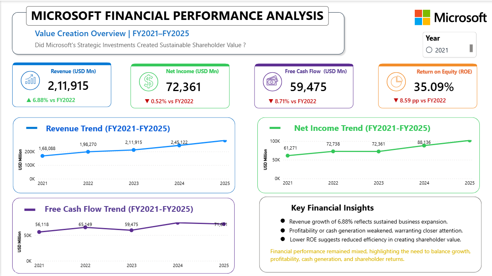
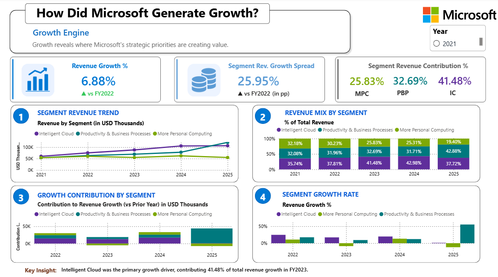
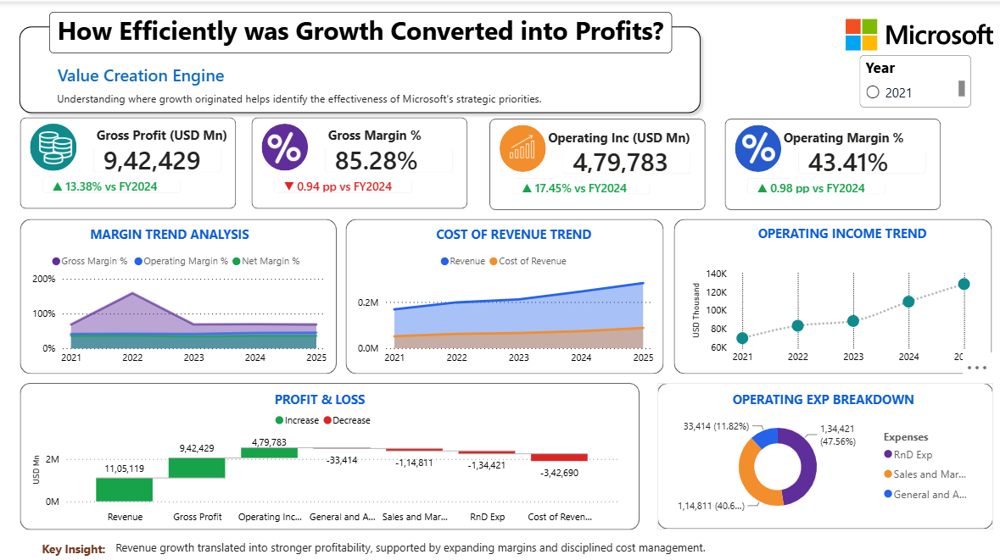
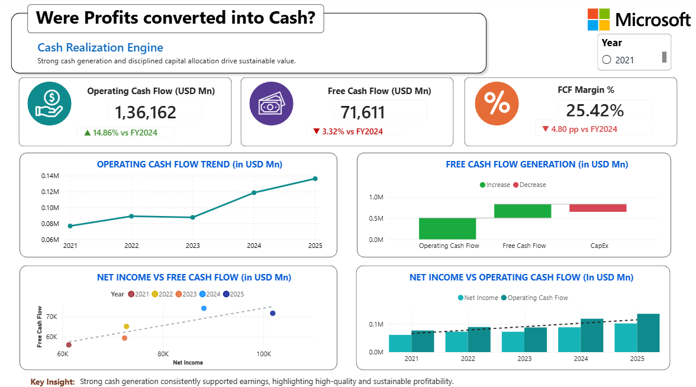
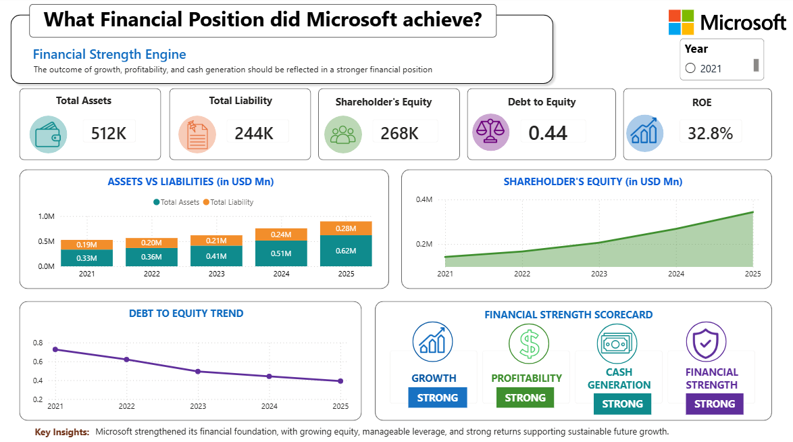

# Microsoft Financial Performance Analysis | FY2021–FY2025

A Power BI dashboard analyzing Microsoft's financial performance over five fiscal years to assess whether strategic investments translated into sustainable shareholder value.

## Project Overview

This project examines Microsoft's financial performance across FY2021–FY2025, connecting revenue growth, segment performance, profitability, cash generation, and financial strength. The report contains five dashboard pages and uses an interactive year slicer to explore performance over time.

## Dashboard Preview

### 1. Value Creation Overview

Tracks revenue, net income, free cash flow (FCF), and return on equity (ROE) to provide an overview of shareholder value creation.

### 2. Growth Engine

Analyzes revenue trends, segment revenue mix, growth rates, and each business segment's contribution to growth.

### 3. Value Conversion Engine

Evaluates gross profit, gross and operating margins, operating income, revenue costs, and operating expense composition.

### 4. Cash Realisation Engine

Examines operating cash flow, free cash flow, FCF margin, capital expenditure, and the relationship between net income and operating cash flow.

### 5. Financial Strength Engine

Reviews assets, liabilities, shareholders' equity, debt-to-equity, and ROE to assess Microsoft's financial position and capital efficiency.

## Key Analytical Areas

- **Growth:** Revenue trends and business-segment contributions.
- **Profitability:** Gross profit, operating income, margins, and operating expenses.
- **Cash Generation:** Operating cash flow, free cash flow, and capital expenditure.
- **Shareholder Returns:** Net income and return on equity.
- **Financial Strength:** Asset and liability trends, shareholders' equity, and leverage.

## Tools Used

- **Microsoft Power BI:** Dashboard development, data visualization, and interactive reporting.
- **Microsoft Excel:** Financial dataset and supporting data preparation.
- **DAX:** Calculated measures and financial KPIs.

## Repository Contents

- `microsoft-financial-performance-dashboard.pbix` — interactive Power BI report.
- `raw-data-microsoft-financial-performance.xlsx` — source dataset used in the analysis.
- PNG screenshots in the repository root — dashboard previews displayed above.

## How to View

1. Download the `.pbix` file and open it in Power BI Desktop.
2. Use the year slicer to explore the report across FY2021–FY2025.
3. Refer to the Excel workbook for the underlying dataset.

## Objective

To evaluate Microsoft's performance through a connected view of growth, profitability, cash realization, shareholder returns, and financial position rather than relying on individual financial metrics in isolation.

---

*Disclaimer: This project is for educational and analytical purposes only and is not investment advice.*
